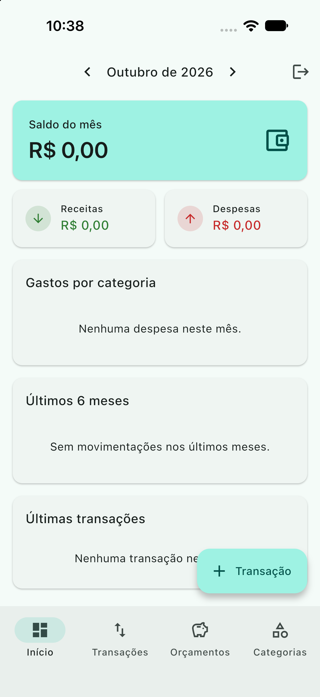
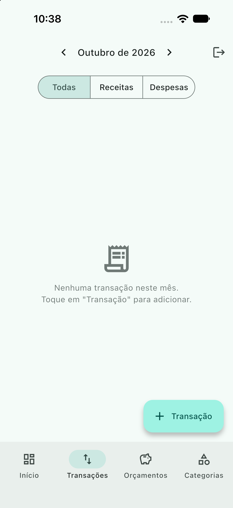

# Finanças: controle financeiro pessoal

[](https://github.com/ArthurPassos16/app_financas/actions/workflows/ci.yml)


App em Flutter para registrar receitas e despesas e acompanhar para onde o dinheiro vai no mês. Os dados ficam no Firebase e sincronizam entre dispositivos, com funcionamento offline.

<p align="center">
  
  
  
</p>

## Funcionalidades

- **Conta própria**: cadastro e login com e-mail e senha, recuperação de senha.
- **Receitas e despesas**: cadastrar, editar e excluir (arrastar para o lado), com valor, categoria, descrição e data.
- **Categorias**: 13 categorias padrão criadas no primeiro acesso, e você pode criar outras com ícone e cor.
- **Dashboard do mês**: saldo, total de receitas e despesas, gráfico de gastos por categoria e evolução dos últimos 6 meses.
- **Orçamentos**: limite mensal por categoria, com barra de progresso e alerta a partir de 80% do limite.
- **Navegação por mês**: todas as telas acompanham o mês selecionado no topo.
- **Offline**: o Firestore grava no cache local e sincroniza quando a conexão volta.
- Tema claro e escuro (Material 3), interface toda em português e valores em R$.

## Arquitetura

O projeto segue Clean Architecture organizada por feature. O domínio não depende de Flutter nem de Firebase.

```
lib/
├── core/
│   ├── di/              # injeção de dependência (get_it)
│   ├── theme/           # tema Material 3 e cores
│   └── utils/           # Money (centavos <-> R$), YearMonth
└── features/
    ├── auth/
    │   ├── domain/      # AppUser, contrato AuthRepository
    │   ├── data/        # implementação com Firebase Auth
    │   └── presentation/# AuthCubit, LoginPage
    └── finance/
        ├── domain/
        │   ├── entities/      # FinanceTransaction, FinanceCategory
        │   ├── repositories/  # contrato FinanceRepository
        │   └── services/      # FinanceCalculator (regras puras)
        ├── data/              # Firestore: repositório e mappers
        └── presentation/      # FinanceCubit, páginas e widgets
```

Algumas decisões:

- **Dinheiro em centavos (`int`)**: evita erro de arredondamento de `double` em somas.
- **Regras de negócio isoladas** em `FinanceCalculator` (resumo do mês, gastos por categoria, histórico e orçamentos). São funções puras e por isso fáceis de testar.
- **Gerência de estado com BLoC (Cubit)**: `FinanceCubit` escuta os streams do Firestore e expõe o estado derivado para as telas.
- **Uma consulta por janela de meses**: o app busca de uma vez os 6 meses que o gráfico mostra e calcula o mês atual em memória.
- **Regras de segurança do Firestore** (`firestore.rules`): cada usuário só lê e escreve os próprios dados, e os campos são validados no servidor.

### Modelo de dados (Firestore)

```
users/{uid}/transactions/{id}  type, amountCents, description, categoryId, date
users/{uid}/categories/{id}    name, type, iconKey, colorValue, monthlyBudgetCents?
```

## Stack

| Camada | Tecnologias |
| --- | --- |
| UI | Flutter, Material 3, fl_chart |
| Estado | flutter_bloc (Cubit), equatable |
| Backend | Firebase Auth, Cloud Firestore |
| DI | get_it |
| Testes | flutter_test, bloc_test, mocktail |
| CI | GitHub Actions (analyze + test) |

## Como rodar

Pré-requisitos: Flutter 3.35 ou superior e uma conta no Firebase.

```bash
git clone https://github.com/ArthurPassos16/app_financas.git
cd app_financas
flutter pub get
```

Configure o Firebase:

1. Crie um projeto no [console do Firebase](https://console.firebase.google.com).
2. Ative **Authentication > E-mail/senha** e crie um banco no **Firestore**.
3. Gere o arquivo de configuração (substitui `lib/firebase_options.dart`):

   ```bash
   dart pub global activate flutterfire_cli
   flutterfire configure
   ```

4. Publique as regras de segurança. No `firebase.json`, adicione `"firestore": { "rules": "firestore.rules" }` e rode:

   ```bash
   firebase deploy --only firestore:rules
   ```

Depois é só rodar:

```bash
flutter run
```

## Testes

```bash
flutter test
```

Os testes cobrem a conversão de valores (`Money`), os meses (`YearMonth`), as regras do `FinanceCalculator` e o comportamento do `AuthCubit` e do `FinanceCubit` com repositórios mockados.

## Próximos passos

- Transações recorrentes (salário, aluguel)
- Exportar o mês em CSV
- Metas de economia
- Testes de widget e de integração

---

Desenvolvido por [Arthur Passos](https://portfolio-tutys.vercel.app).
